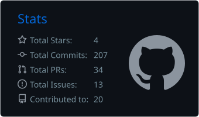
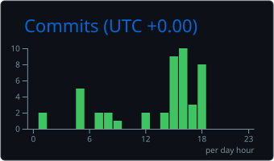

  

<h3 align="center">Hi, I'm Mani — aka Crown 👑</h3>

  
  
  
  

### 🧩 About

- 🛠️ **Backend Engineer @WeSee** — payments, refunds, payouts and settlement in **Node.js / TypeScript + PostgreSQL**, integrated with third-party venues and providers.
- 🌀 Ex-Software Engineer **@GlueX Protocol** — AWS data pipelines indexing 12+ chains.
- 🧯 I design for failure: **idempotent webhooks & jobs, row locking, retries with dead-lettering, reconciliation.**
- 🏅 **5× ETHGlobal** finalist / winner.
- 🤝 Open-source contributor — **@vllm-project (AIBrix)**, **@kleros**.

### 🌱 Open Source

| Project | Contribution | Status |
| --- | --- | --- |
| **vllm-project/aibrix** | [#3540](https://github.com/vllm-project/aibrix/pull/3540) — register a webhook only when its API group is in the scheme |  |
| **vllm-project/aibrix** | [#3570](https://github.com/vllm-project/aibrix/pull/3570) — let the manager find a prefixed install's webhook objects |  |
| **vllm-project/aibrix** | [#3578](https://github.com/vllm-project/aibrix/pull/3578) — keep a rollout's drains within `maxUnavailable` |  |
| **vllm-project/aibrix** | [#3579](https://github.com/vllm-project/aibrix/pull/3579) — cancel a rollout drain when the template is reverted |  |
| **vllm-project/aibrix** | [8 bugs reported →](https://github.com/vllm-project/aibrix/issues?q=author%3AManiBAJPAI22) — gateway memory DoS, SSRF, autoscaler starvation, rollout drain, standalone-overlay crashes |  |
| **kleros/kleros-v2** | [#2104](https://github.com/kleros/kleros-v2/pull/2104) — loading & error states + hardened price fetch |  |

### 🚀 Featured projects

| Project | What it is | Stack |
| --- | --- | --- |
| [**degenOS**](https://github.com/ManiBAJPAI22/degenOS) | 🏆 Winner @ ETHGlobal Bangkok | TypeScript |
| [**vertigo**](https://github.com/PrathmeshRanjan/vertigo) | On-chain prediction-market engine — LOPMM pricing across Uniswap v4 / 1inch venues | TypeScript · Solidity |
| [**sift-cli**](https://github.com/ManiBAJPAI22/sift-cli) | One-command Solidity audit pipeline (Slither, Aderyn, fuzzing) with LLM triage to cut false positives | Python |
| [**ZK-match**](https://github.com/ManiBAJPAI22/ZK-match) | Privacy-preserving biometric matching with Zero-Knowledge Proofs (anti-Sybil) | JavaScript |
| [**Cross-Chain-Aggregator**](https://github.com/ManiBAJPAI22/Cross-Chain-Aggregator) | Cross-chain DeFi swaps/transfers across Optimism & Osmosis via Axelar, with pathfinding | JavaScript |
| [**SSM**](https://github.com/ManiBAJPAI22/SSM) | Multimodal (audio + text) model training, ONNX export, gRPC serving, Next.js UI, Prometheus/Grafana | Go |

### 🛠️ Tech

**Languages**

**Backend & data**

**Cloud & infra**

### 📊 Stats

  

  
  

  <picture>
    <source media="(prefers-color-scheme: dark)" srcset="https://raw.githubusercontent.com/ManiBAJPAI22/ManiBAJPAI22/output/github-snake-dark.svg"/>
    <source media="(prefers-color-scheme: light)" srcset="https://raw.githubusercontent.com/ManiBAJPAI22/ManiBAJPAI22/output/github-snake.svg"/>
    
  </picture>

  

